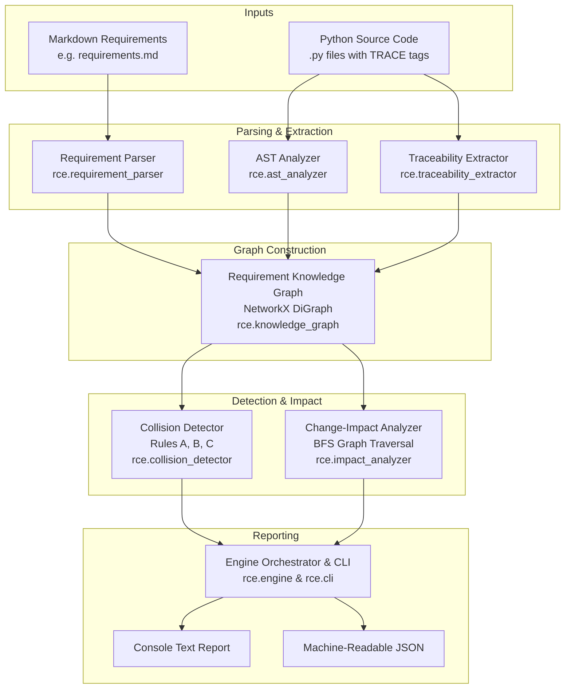

# Requirement Collision Engine (RCE)

A general-purpose static analysis and change-impact engine for Python applications that identifies potential business requirement collisions, boundary overlaps, and override interactions directly from source code and requirements specifications without executing target code.

---

## 1. Project Overview and Motivation

In software systems undergoing continuous evolution, business requirements change frequently. A common and costly failure mode occurs when:
> *A software system passes all its existing unit and regression tests, yet a newly introduced business requirement silently contradicts, overlaps, or bypasses an existing rule.*

Traditional testing verifies only that implemented code satisfies known test cases; it cannot easily determine whether two separate requirements encode contradictory threshold logic or whether an emergency waiver inadvertently bypasses mandatory audit or compliance constraints.

The **Requirement Collision Engine (RCE)** addresses this challenge by parsing Markdown specifications, statically analyzing Python source code via Abstract Syntax Trees (AST), building a unified NetworkX knowledge graph, detecting potential requirement collisions, and providing graph-based change-impact analysis.

---

## 2. Problem Statement and Objectives

### Problem Statement
Requirement conflicts in software engineering are typically discovered late in the development lifecycle—often in staging or production. In dynamic languages such as Python, lack of compile-time verification exacerbates this issue. Furthermore, requirements and source code frequently diverge when traceability is not systematically maintained.

### Objectives
1. **Automated Traceability & Knowledge Graph Construction**: Extract requirement tags from Python docstrings and construct a queryable bipartite/dependency graph connecting requirements, source files, functions, AST decision conditions, and test cases.
2. **Deterministic, Rule-Based Collision Detection**: Identify potential requirement collisions using grounded static evidence (line numbers, variables, AST operators, and requirement excerpts) without requiring execution or large language models (LLMs).
3. **Change-Impact Analysis**: Trace direct and transitive impacts when a requirement, function, module, or collision finding is modified.
4. **General-Purpose Reusability**: Provide an extensible CLI and Python API that works across diverse Python application domains beyond the reference application.

---

## 3. Implemented Features

* **Markdown Requirement Parser (`rce.requirement_parser`)**: Extracts requirement identifiers, titles, and descriptions from Markdown specifications supporting various heading formats (`### REQ-01 — Title` or `### REQ-01: Title`).
* **Python AST Static Analyzer (`rce.ast_analyzer`)**: Analyzes Python modules without executing or importing them. Extracts classes, functions, calls, imports, binary comparison conditions (`>`, `<`, `==`, `!=`, etc.), and variable references. Automatically excludes `.venv`, cache directories, and test suites from target application modules.
* **Traceability Extractor (`rce.traceability_extractor`)**: Discovers explicit docstring tags matching `TRACE: REQ-XX[, REQ-YY]` on modules, classes, and functions.
* **NetworkX Knowledge Graph (`rce.knowledge_graph`)**: Builds a directed graph modeling `CONTAINS`, `IMPLEMENTS`, `CALLS`, `HAS_CONDITION`, and `VERIFIES` relationships.
* **Deterministic Collision Detector (`rce.collision_detector`)**:
  * **Rule A**: Shared implementation functions tracing multiple requirements with overlapping decision conditions.
  * **Rule B**: Contradictory numeric comparisons, discrete equality conflicts, and boundary interval overlaps on shared variables across distinct requirements.
  * **Rule C**: Override/bypass interactions where exception rules alter the control flow of standard enforcement gates.
* **Change-Impact Analyzer (`rce.impact_analyzer`)**: BFS graph traversal determining direct (Hop 1) and transitive (Hop 2+) impacts across caller-callee hierarchies, associated requirements, and regression test suites.
* **CLI & Orchestration Layer (`rce.engine`, `rce.cli`)**: Unified CLI providing structured human-readable text and clean machine-readable JSON output. Supports configurable root, source directories, impact targets, and custom output files.

---

## 4. Architecture and Analysis Pipeline

The RCE analysis pipeline processes target repositories through six sequential stages:



---

## 5. Specification and Traceability Conventions

### 5.1 Requirements Markdown Format
Requirements are defined in a Markdown file using level-3 headings containing standard requirement identifiers:

```markdown
# Logistics & Shipping Specification

### REQ-01 — Heavy Freight Surcharge
Shipments with weight exceeding **50.0** kg must incur a heavy freight surcharge of $25.00.
Shipments at or below 50.0 kg do not incur surcharge under this threshold rule.

### REQ-02 — Express Shipping Waiver
Express shipping orders with weight below **75.0** kg receive a waiver bypassing the Heavy Freight Surcharge (REQ-01) without the normal heavy freight stage.

### REQ-03 — Remote Delivery Eligibility
Orders delivered to destination zone code equal to **ZONE_REMOTE** must not be dispatched via standard courier.
```

### 5.2 Python Traceability Docstring Format
Link functions, classes, or test cases to requirements using `TRACE:` tags inside their docstrings:

```python
"""Shipping surcharge calculation module.

TRACE: REQ-01
"""

def calculate_freight_surcharge(weight: float) -> float:
    """Calculate heavy freight surcharge.

    TRACE: REQ-01
    """
    if weight > 50.0:
        return 25.0
    return 0.0


def dispatch_cargo(weight: float, is_express: bool) -> bool:
    """Dispatch decision gate evaluating surcharge and waiver.

    TRACE: REQ-01, REQ-02
    """
    surcharge = calculate_freight_surcharge(weight)
    is_override = is_express and (weight < 75.0)
    if not (surcharge == 0.0 or is_override):
        return False
    return True
```

In test suites, trace tags link test cases to verified requirements:

```python
def test_freight_rate():
    """Verify heavy freight calculation.

    TRACE: REQ-01
    """
    assert calculate_freight_surcharge(60.0) == 25.0
```

---

## 6. Installation & Environment Setup

RCE is built purely with Python 3.10+ standard libraries and `networkx` for graph analysis. It does **not** require Node.js, external databases, or LLM API keys.

### 6.1 Setup on Windows PowerShell

```powershell
# 1. Clone repository
git clone https://github.com/shraddhaajit/requirement-collision-engine.git
cd "requirement-collision-engine"

# 2. Create and activate virtual environment
python -m venv .venv
.\.venv\Scripts\Activate.ps1

# 3. Install dependencies
pip install -r requirements.txt
```

### 6.2 Dependencies (`requirements.txt`)
```text
pytest>=7.0.0
networkx>=3.0
```

---

## 7. Command-Line Interface (CLI) Usage

The CLI can be invoked using `rce` (if installed) or directly via `python -m rce.cli`.

### 7.1 Basic Analysis (Human-Readable Text)
Run default analysis on the repository:
```powershell
python -m rce.cli
```

Analyze with specific source directories and requirements file:
```powershell
python -m rce.cli --project-root . --requirements requirements/requirements.md --source-dirs cews
```

### 7.2 Change-Impact Analysis
Perform change-impact analysis starting from a requirement ID, function name, module, or collision ID:
```powershell
# Impact of requirement REQ-07
python -m rce.cli --impact REQ-07

# Impact starting from a specific function
python -m rce.cli --impact cews.approval:manager_override

# Impact starting from a collision finding
python -m rce.cli --impact COL-RULE_B-REQ-03-REQ-07-AMOUNT --max-depth 4
```

### 7.3 Machine-Readable JSON Output
Emit JSON directly to stdout for CI/CD scripting:
```powershell
python -m rce.cli --format json
```

Save JSON report to an output file:
```powershell
python -m rce.cli --format json --output report.json
```

### 7.4 Strict Mode for CI/CD Quality Gates
Return exit code `2` if any potential collisions are detected (ideal for pull request checks):
```powershell
python -m rce.cli --strict
```

### 7.5 CLI Options Reference
```text
options:
  -h, --help            Show help message and exit
  -p, --project-root    Project root directory (default: .)
  -r, --requirements    Path to Markdown requirements file (default: requirements/requirements.md)
  -s, --source-dirs     Specific source subdirectories to analyze (e.g. cews src)
  -i, --impact          Target requirement ID, function name, module, or collision ID
  -d, --max-depth       Maximum graph traversal depth for impact analysis (default: 3)
  -f, --format {text,json}
                        Output format (default: text)
  -o, --output          Path to file to write output report
  --strict              Exit with code 2 if collisions are detected, 1 on error
  -v, --version         Show program's version number and exit
```

---

## 8. Interpreting Findings and Severity

RCE findings represent **potential static collisions** that require human engineering review. They do not constitute formal mathematical proofs of runtime invalidity.

### Severity Levels
* **`HIGH`**: Direct logical contradictions (e.g., opposing comparisons on identical thresholds) or critical override of mandatory security/audit gates.
* **`MEDIUM`**: Boundary interval overlaps (e.g., `amount > 10000` and `amount < 15000`) or standard workflow overrides.
* **`LOW`**: Shared implementation conditions with multiple requirement tags requiring architectural confirmation.
* **`WARNING`**: Inconclusive interactions where source evidence is partial or ambiguous.

### Confidence Levels
* **`HIGH`**: Backed by both parsed requirement text and matching AST source-code conditions on the same variable.
* **`MEDIUM`**: Backed by AST conditions on compatible variables across related call paths.
* **`LOW`**: Inferred primarily from requirement documentation keywords or graph proximity.

### Grounded Evidence
Every finding includes explicit source file paths, line numbers, variable names, and code snippets:
```text
  [1] COL-RULE_B-REQ-03-REQ-07-AMOUNT
      Category     : BOUNDARY_CONDITION_COLLISION
      Severity     : MEDIUM | Confidence: HIGH
      Rule         : Rule B — Conflicting conditions
      Requirements : REQ-03, REQ-07
      Functions    : check_manager_approval, manager_override
      Explanation  : Boundary interval overlap on variable 'amount' between 10,000.00 and 15,000.00.
                     Conditions 'amount > 10000.0' (REQ-03) and 'amount < 15000.0' (REQ-07)
                     simultaneously evaluate to true in this range.
      Evidence     :
        - Condition 1 in cews/approval.py:25 (check_manager_approval): 'amount > 10000.0'
        - Condition 2 in cews/approval.py:102 (manager_override): 'amount < 15000.0'
        - Target attribute: 'amount'
      Human Review : Required
```

---

## 9. Supported Project Layouts & Discovery Rules

RCE supports multi-module Python projects following standard packaging conventions:

1. **Monorepo / Package Root**: Projects with source packages in subdirectories (e.g., `cews/`, `warehouse/`, `inventory/`, `src/`).
2. **Configured Source Directories**: Users can explicitly restrict analysis using `--source-dirs <dir1> <dir2>`.
3. **Automatic Exclusion Safeguards**:
   - Virtual environments (`.venv`, `venv`, `env`).
   - Version control directories (`.git`).
   - Bytecode and cache directories (`__pycache__`, `.pytest_cache`, `.mypy_cache`).
   - Test directories (`tests`, `test`, `testing`) and test files (`test_*.py`) are cataloged for test-traceability but automatically excluded from application logic analysis.
   - When analyzing the CEWS reference workspace, RCE's own implementation directory (`rce/`) is excluded from target code analysis.

---

## 10. Current Limitations & Scope

* **Static Heuristics, Not Formal Verification**: RCE identifies *potential* collisions via syntactic AST patterns. An interval overlap (e.g. `weight > 50` and `weight < 75`) flags a region where both rules apply simultaneously; whether this represents a defect or intended multi-tiered logic requires human review.
* **Dynamic Python Limitations**: Static AST analysis cannot evaluate dynamically constructed attributes (`getattr(obj, name)`), runtime monkey patching, dynamic database queries, or `eval()` expressions.
* **Docstring Traceability Dependency**: Explicit requirement-to-code links depend on docstring `TRACE:` tags. Code lacking tags can only be connected via call-graph inference from tagged functions.
* **Single-Expression Conditions**: Multi-statement compound conditions computed across several lines without direct comparison expressions are not fully deconstructed into atomic intervals.
* **Validation Scope**: Validated on the CEWS enterprise workflow and two controlled synthetic domains (Logistics and Inventory). Broad generalization across arbitrary legacy open-source projects has not yet been benchmarked.

---

## 11. Test Execution and Verified Test Totals

The entire test suite can be run using `pytest`:

```powershell
.venv\Scripts\pytest -v
```

### Verified Test Suite Breakdown (125 Passing Tests)
| Test Suite Module | Test Count | Scope Verified |
|---|---|---|
| [`tests/test_cews.py`](file:///c:/Users/shrad/OneDrive/Desktop/sw%20theory%20project/tests/test_cews.py) | **24** | Original CEWS baseline (Requirement, Boundary, Interaction tests) |
| [`tests/test_rce_parser.py`](file:///c:/Users/shrad/OneDrive/Desktop/sw%20theory%20project/tests/test_rce_parser.py) | **12** | Markdown specification parsing, heading formats, error handling |
| [`tests/test_rce_traceability.py`](file:///c:/Users/shrad/OneDrive/Desktop/sw%20theory%20project/tests/test_rce_traceability.py) | **14** | Docstring tag extraction, class/method traces, malformed tags |
| [`tests/test_rce_ast_analyzer.py`](file:///c:/Users/shrad/OneDrive/Desktop/sw%20theory%20project/tests/test_rce_ast_analyzer.py) | **12** | AST visitor, condition parsing, call graph, directory exclusion |
| [`tests/test_rce_knowledge_graph.py`](file:///c:/Users/shrad/OneDrive/Desktop/sw%20theory%20project/tests/test_rce_knowledge_graph.py) | **11** | NetworkX node/edge creation, bipartite traceability links |
| [`tests/test_rce_collision_detector.py`](file:///c:/Users/shrad/OneDrive/Desktop/sw%20theory%20project/tests/test_rce_collision_detector.py) | **13** | Rules A, B, C detection, boundary overlaps, duplicate suppression |
| [`tests/test_rce_impact_analyzer.py`](file:///c:/Users/shrad/OneDrive/Desktop/sw%20theory%20project/tests/test_rce_impact_analyzer.py) | **15** | Direct vs. transitive impact classification, regression test discovery |
| [`tests/test_rce_cli.py`](file:///c:/Users/shrad/OneDrive/Desktop/sw%20theory%20project/tests/test_rce_cli.py) | **8** | CLI options, arguments, exit codes, text/JSON streaming |
| [`tests/test_rce_engine.py`](file:///c:/Users/shrad/OneDrive/Desktop/sw%20theory%20project/tests/test_rce_engine.py) | **10** | End-to-end orchestration, syntax error tolerance, partial analysis |
| [`tests/test_rce_validation_projects.py`](file:///c:/Users/shrad/OneDrive/Desktop/sw%20theory%20project/tests/test_rce_validation_projects.py) | **6** | Domain Project A (Logistics), Project B (Inventory), discovery audit |
| **Total Passed Tests** | **125** | **Zero failures, zero regressions** |

---

## 12. Completed Functionality vs. Future Work

### Completed Functionality (Phases 1–7)
* [x] Markdown requirement parser with validation and normalization.
* [x] Python AST static analysis extracting functions, calls, and conditions without execution.
* [x] Docstring-based requirement-to-code traceability extraction.
* [x] NetworkX bipartite knowledge graph with multi-edge relationship modeling.
* [x] Deterministic collision detector with grounded evidence for Rules A, B, and C.
* [x] Graph-based change-impact analysis classifying direct and transitive artifacts.
* [x] Unified CLI with text and clean JSON reporting for CI/CD integration.
* [x] Partial analysis and audit warnings for syntax errors.
* [x] Controlled validation across CEWS and two independent domains (Warehouse and Inventory).

### Future Work
* [ ] SMT-based constraint solving (e.g. Z3) for complex multi-variable predicates.
* [ ] Natural Language Processing (NLP) / LLM assistance for requirements lacking explicit Markdown identifiers.
* [ ] Git-history mining to correlate requirement collisions with commit authoring patterns.
* [ ] Interactive web visualization dashboard (e.g., Pyvis / HTML graph rendering).
* [ ] Large-scale empirical benchmarking against open-source enterprise Python repositories.
