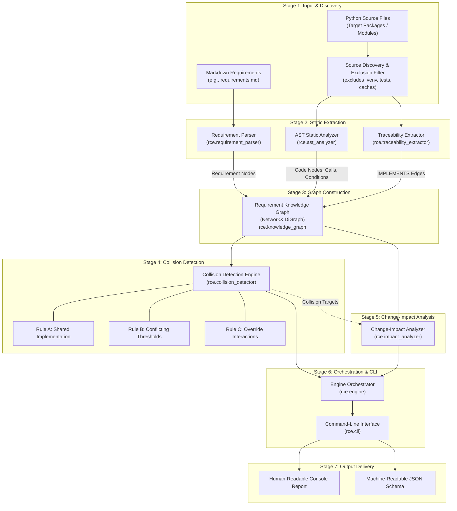

# Requirement Collision Engine (RCE) — Architecture Document

## 1. System Overview

The **Requirement Collision Engine (RCE)** is a static analysis and change-impact framework designed to detect potential business rule collisions, boundary condition overlaps, and exception/bypass interactions in Python software systems. 

RCE bridges the semantic gap between high-level functional requirements and concrete source code by constructing a queryable **Requirement Knowledge Graph**. It performs deterministic static reasoning directly on Abstract Syntax Trees (AST) and requirement specifications without executing target code or requiring external machine learning models.

The **Controlled Enterprise Expense Workflow System (CEWS)** serves as the primary controlled reference target application, alongside independent domain projects in logistics and inventory management.

---

## 2. End-to-End Pipeline Architecture

The RCE analysis pipeline processes target repositories through seven coordinated stages:

---

## 3. Module Responsibilities and Layering

| Module | Responsibility | Key Classes & Functions |
|---|---|---|
| [`rce.requirement_parser`](file:///c:/Users/shrad/OneDrive/Desktop/sw%20theory%20project/rce/requirement_parser.py) | Parses Markdown requirement files, extracts IDs (`REQ-XX`), titles, descriptions, and validates structural integrity. | `Requirement`, `parse_requirements()`, `validate_requirements()` |
| [`rce.ast_analyzer`](file:///c:/Users/shrad/OneDrive/Desktop/sw%20theory%20project/rce/ast_analyzer.py) | Statically inspects Python code using the `ast` module without importing or executing files. Extracts functions, classes, calls, imports, and binary comparison conditions. | `CodeVisitor`, `analyze_project()`, `analyze_source_file()`, `ConditionInfo`, `FunctionInfo`, `ModuleInfo` |
| [`rce.traceability_extractor`](file:///c:/Users/shrad/OneDrive/Desktop/sw%20theory%20project/rce/traceability_extractor.py) | Extracts `TRACE: REQ-XX` tags from module, class, and function docstrings. | `TraceItem`, `extract_traceability_from_file()`, `extract_traceability_from_dir()` |
| [`rce.knowledge_graph`](file:///c:/Users/shrad/OneDrive/Desktop/sw%20theory%20project/rce/knowledge_graph.py) | Builds a unified directed graph using NetworkX. Models artifact containment, call hierarchies, condition attachments, and test verification links. | `build_knowledge_graph()`, `get_artifacts_for_requirement()`, `get_requirements_for_artifact()` |
| [`rce.collision_detector`](file:///c:/Users/shrad/OneDrive/Desktop/sw%20theory%20project/rce/collision_detector.py) | Evaluates potential semantic and boundary collisions across requirements using grounded AST evidence. | `CollisionFinding`, `detect_collisions()`, `_check_rule_a_shared_conditions()`, `_check_rule_b_conflicting_conditions()`, `_check_rule_c_override_interactions()` |
| [`rce.impact_analyzer`](file:///c:/Users/shrad/OneDrive/Desktop/sw%20theory%20project/rce/impact_analyzer.py) | Performs BFS graph traversal to calculate direct (Hop 1) and transitive (Hop 2+) change impacts and identifies regression test suites. | `ImpactReport`, `ImpactItem`, `analyze_impact()`, `analyze_impact_from_requirement()`, `analyze_impact_from_collision()` |
| [`rce.engine`](file:///c:/Users/shrad/OneDrive/Desktop/sw%20theory%20project/rce/engine.py) | Orchestrates the end-to-end pipeline, handles partial analysis on syntax errors, and aggregates project statistics. | `EngineResult`, `run_engine()`, `format_text_output()`, `STATUS_COMPLETE`, `STATUS_PARTIAL` |
| [`rce.cli`](file:///c:/Users/shrad/OneDrive/Desktop/sw%20theory%20project/rce/cli.py) | Command-line interface providing argument parsing, text/JSON streaming, file output, and exit code management. | `main()`, `build_parser()` |

---

## 4. Knowledge Graph Schema

RCE uses a directed NetworkX graph (`DiGraph`) where nodes represent specification or software artifacts and edges represent syntactic or semantic relationships.

### 4.1 Node Types
1. **`requirement`** (`req:REQ-XX`): Functional business rule parsed from Markdown. Contains `req_id`, `title`, and `description`.
2. **`module`** (`module:pkg.mod`): Python module or source file. Contains `module_name` and `file_path`.
3. **`class`** (`class:pkg.mod.ClassName`): Class definition within a module. Contains `class_name` and `line_number`.
4. **`function`** (`function:pkg.mod:func_name`): Function or method definition. Contains `function_name`, `is_method`, `line_number`, and `traceability_ids`.
5. **`condition`** (`condition:pkg.mod:func:Lxx`): Decision condition extracted from an `if`, `while`, or `assert` AST node. Contains `expression`, `target_var`, `operator`, `literal_value`, and `is_numeric`.
6. **`test`** (`test:tests.test_mod:test_fn`): Test function verifying system behavior. Contains `test_name` and verified requirement IDs.

### 4.2 Edge Types
* **`CONTAINS`**: Hierarchical enclosure (`module` $\rightarrow$ `function`, `module` $\rightarrow$ `class`, `class` $\rightarrow$ `function`).
* **`IMPLEMENTS`**: Explicit traceability link (`requirement` $\rightarrow$ `function` or `requirement` $\rightarrow$ `class`).
* **`CALLS`**: Direct function invocation (`function` $\rightarrow$ `function`).
* **`HAS_CONDITION`**: Attachment of decision logic (`function` $\rightarrow$ `condition`).
* **`VERIFIES`**: Direct test verification link (`test` $\rightarrow$ `requirement`).

---

## 5. Collision Detection Rules

RCE implements three explainable detection rules:

### Rule A — Shared Implementation with Overlapping Conditions
* **Pattern**: A single implementation function traces multiple requirements (e.g. `TRACE: REQ-01, REQ-02`) and evaluates multiple conditions.
* **Semantic Rationale**: When multiple distinct business requirements are multiplexed into a single function, localized logic changes easily trigger unintended side effects across co-implemented rules.
* **Severity**: `LOW` to `MEDIUM` | **Confidence**: `MEDIUM`.

### Rule B — Conflicting Conditions and Boundary Overlaps
* **Pattern**: Two distinct requirements trace functions that evaluate conditions on the same variable name.
* **Subcases**:
  1. *Direct Contradiction*: Opposing comparison operators on identical threshold values (e.g., `x > 100` vs. `x <= 100` or `status == "A"` vs. `status == "B"`).
  2. *Boundary Interval Overlap*: Opposing inequalities defining an open interval where both conditions evaluate to true simultaneously (e.g., `amount > 10000.0` and `amount < 15000.0` $\rightarrow$ overlapping range `(10000, 15000)`).
* **Severity**: `HIGH` (direct contradiction) or `MEDIUM` (boundary interval overlap) | **Confidence**: `HIGH`.

### Rule C — Explicit Exception and Override Interactions
* **Pattern**: A requirement specifies exception or bypass semantics (e.g. keywords: *override*, *bypass*, *waiver*, *emergency*) targeting another standard enforcement rule, and code-level decision gates reflect this bypass in disjunctive logic (e.g., `if not (standard_check or is_override):`).
* **Severity**: `HIGH` (if mandatory compliance/audit rules are bypassed) or `MEDIUM` (standard workflow override) | **Confidence**: `HIGH`.

---

## 6. Change-Impact Analysis Model

The impact analyzer calculates ripple effects across the knowledge graph using Breadth-First Search (BFS):

1. **Impact Seeding**: Can be initiated from a Requirement ID, Function Qualified Name, Module Name, or Collision ID.
2. **Direct Impact (Hop 1)**: Artifacts directly linked to the target (e.g. functions implementing the requirement, enclosing modules, and explicitly tagged tests). Marked with `inferred = False`.
3. **Transitive Impact (Hop 2+)**: Artifacts reached via caller/callee traversal, module containment, and co-implementing requirements. Marked with `inferred = True`.
4. **Cycle Suppression**: Visited nodes and traversed edges are recorded in closed sets to guarantee termination even in recursive or cyclic call graphs.
5. **Regression Test Identification**: Collects all test nodes reachable from any impacted function or requirement to recommend a targeted test execution subset.

---

## 7. Static Analysis Constraints & Dynamic Python Boundaries

RCE relies strictly on static AST analysis. Consequently, certain dynamic behaviors of the Python runtime are inherently outside its analytical scope:

1. **Dynamic Attribute Dispatch**: Calls via `getattr()`, `setattr()`, or `__getitem__` on dynamically constructed strings cannot be statically bound to specific function nodes.
2. **Runtime Monkey Patching**: In-memory patching of module attributes at runtime alters the effective call graph without modifying static source files.
3. **Duck Typing and Polymorphism**: In dynamic Python, two functions may access an attribute `.amount` on entirely different runtime object types. RCE mitigates this by requiring traceable call chains or shared requirement contexts before comparing variable names.
4. **Non-Executable Constraint**: RCE deliberately does not execute target code. It avoids import side-effects, database connections, or environment dependencies, ensuring deterministic analysis across clean execution environments.
5. **Human Review Requirement**: A static collision finding identifies an architectural or logic intersection that warrants scrutiny; it does not constitute a mathematical proof of a defect.

---

## 8. Target Application Integration (CEWS Reference)

In the CEWS reference application, RCE models the interaction between 10 business requirements across 4 core modules:
* `cews.expense`: Requirement submission and input validation (`REQ-01`).
* `cews.approval`: Threshold validation (`REQ-02`, `REQ-03`, `REQ-05`, `REQ-06`), manager override (`REQ-07`), emergency bypass (`REQ-08`), and final approval gate (`REQ-10`).
* `cews.compliance`: HR compliance verification (`REQ-04`).
* `cews.audit`: Audit logging recording (`REQ-09`).

RCE detects the documented interaction between `REQ-03` (> ₹10,000) and `REQ-07` (< ₹15,000) as a boundary interval overlap on variable `amount`, while correctly verifying that emergency bypass (`REQ-08`) interacts with manager approval (`REQ-03`) via Rule C.
